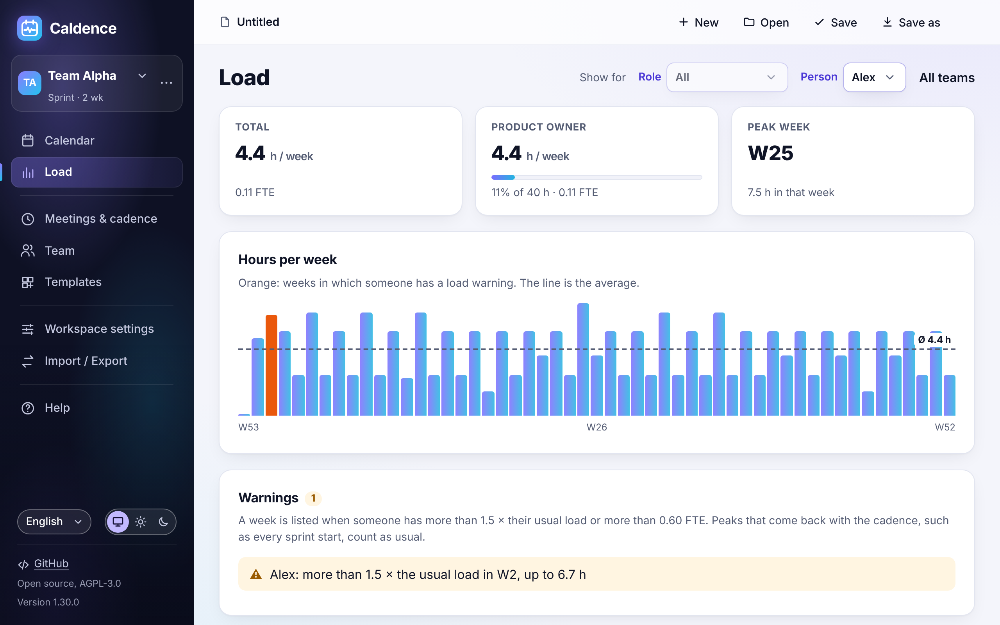
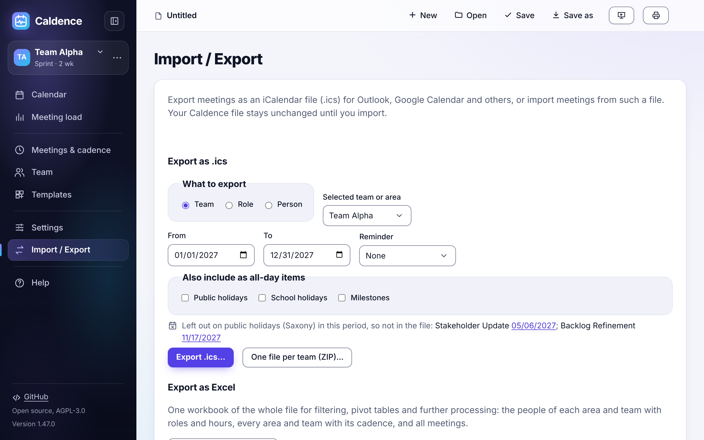

# Caldence

Open-source calendar tool for planning the recurring meetings of agile roles (Product Owner, Scrum Master, teams) and exporting them to Outlook and other calendar apps.

Status: stable, see the [latest release](https://github.com/gallandp/caldence/releases/latest) and the [changelog](CHANGELOG.md). Live at [caldence.de](https://caldence.de).







## Features

- **Plan new:** a short wizard sets up the first team from Scrum, Kanban, SAFe or an empty team, with its people, time zone, holidays and planning horizon. Further teams start from the team menu.
- **Areas:** group several teams into one unit with its own people, hours and meetings, for example a department or a release train. A structure tree shows who works where and how many hours a week; an overview compares the teams' cadences and meeting load (a week is outlined when a member is over the limit, judged on all their teams), and a click on a team, meeting or week shows it without opening an edit form, with one click back to the overview; on phones its time and cost per team and its most expensive meetings are cards, with the cost on top. Meetings of the area can invite a role from every team. The two levels can be renamed (Area/Team, Department/Team, Platform/Product, Chapter/Unit, Release Train/Team or your own names).
- **Team:** create people and roles where they are assigned; a person can hold several roles and work different weekly hours in each team (for example 20 h in one team and 18 h in another). Adding someone who is already in another team, here or in the setup wizard, fills in the hours they have left, and the Team view (member list and people pool), Meeting load and the area structure flag a person whose hours add up to more than the default hours per week. Assumptions such as the team size scale meeting durations. The Team view also lists the people and roles of the whole workspace.
- **Meetings & cadence:** the team's cadence (sprint, flow or program increment; a new length keeps end-of-sprint meetings such as Review and Retrospective at the end), cycles with milestones and the meetings in one place. Repeat rules: weekly, selected weekdays, every n weeks, monthly nth weekday, cadence day, cycle milestone and once. The meetings table sorts by meeting, next date or cost and groups by category; on phones each meeting is a card. While you edit a meeting, the form shows its effect on hours, meeting load and cost before you save.
- **Calendar:** Week, Month and Horizon (every week of the planning horizon in one table), with public and school holidays, the cadence and milestones, and filters for one role or one person across all teams. With an area selected, it shows the meetings of all its teams and its own.
- **Meeting load:** hours per week of everyone in scope (a typical week and the average in the planning horizon), by role and person with their share in meetings (each person judged on all their teams and areas, with their part in the chosen team next to it) and their room before the limit, a weekly chart, and warnings for weeks over the one limit (share of weekly hours in meetings, set in Settings) or with a load spike; peaks that come back with the cadence are ignored. Time in an area is counted on its own and does not raise a team's load. It counts meeting time only, not other work.
- **Meeting costs (optional):** with an hourly rate, Meetings, Meeting load and the area overview show what meetings cost per week and in the planning horizon, which every such figure names (for example "2027, 52 wks"); while presenting, the what-if bar shows the change in both. Meetings & cadence also shows the cost per sprint or PI (not for flow) and, per meeting, its preparation share.
- **Print and PDF:** prints the current view, also while presenting with its what-ifs, with one line naming the file, print date, hourly rate and planning horizon.
- Templates for Scrum, Kanban and SAFe (with a Release Train area above the team), plus your own template files; exporting a team as a template also writes its area.
- Calendar export and import as `.ics` files (Outlook, Google Calendar, Apple Calendar), also one file per team or area as a ZIP (with an area selected in a file with several areas, only that area and its teams); exporting again updates the entries of the earlier export in apps that support it. The export opens on what this browser exported last, or on your own person after "I take part myself" in the wizard.
- Public holidays of all 16 German states (school holidays for Saxony so far); region files import your own holiday data.
- Installable app that works offline and asks before updating; works on phones.
- German and English interface; light, dark or matching the system.
- Accessible: keyboard operation, built for screen readers, targeting WCAG 2.2 AA (see the [accessibility statement](docs/accessibility.md)).
- Private: everything stays in your browser; workspaces are files you save and open yourself.

## Screenshots

All screenshots are generated by `npm run screenshots`. The German interface: [start screen](docs/screenshots/start-de.png), [calendar](docs/screenshots/calendar-de.png), [calendar horizon](docs/screenshots/weeks-de.png), [load](docs/screenshots/load-de.png), [meetings](docs/screenshots/meetings-de.png), [area structure](docs/screenshots/structure-de.png), [area overview](docs/screenshots/overview-de.png), [templates](docs/screenshots/templates-de.png), [import / export](docs/screenshots/exchange-de.png) and [help](docs/screenshots/help-de.png). The [area overview](docs/screenshots/overview-en.png) in English, and the calendar in [dark mode](docs/screenshots/calendar-en-dark.png).

## Quick start

- **Use it online:** open [caldence.de](https://caldence.de) in a current browser.
- **Host it yourself:** download the release ZIP from the GitHub releases page, upload it to a web server and follow the [deployment guide](docs/deployment.md).

## Using Caldence

Choose **Plan new** on the start screen, or **Open the example** to look around first. The **Help** view in the app has the first steps, a chapter on every view, one on areas (grouping teams), where each setting lives, how files and autosave work, and the keyboard shortcuts. Everything stays in your browser; nothing is sent anywhere.

If a workspace keeps the app from starting, add `?reset` to the address (for example `https://caldence.de/?reset`) to start with an empty one; see [limits](docs/workspace-format.md#limits).

File formats: [workspace](docs/workspace-format.md), [template](docs/template-format.md) and [region](docs/region-format.md).

## Development

```sh
npm ci           # install dependencies
npm run dev      # start the dev server
npm test         # unit tests
npm run e2e      # end-to-end tests (Playwright)
npm run build    # production build into dist/
```

`dist/` is a static site that can be uploaded to any web server. `npm run package` zips it as `caldence-<version>.zip`. See the [deployment guide](docs/deployment.md).

See [CONTRIBUTING.md](CONTRIBUTING.md) for how to contribute.

## License

Licensed under the [GNU Affero General Public License v3.0 or later](LICENSE) (AGPL-3.0-or-later). If you run a modified version for others, for example on a website, you must offer them its source code.
