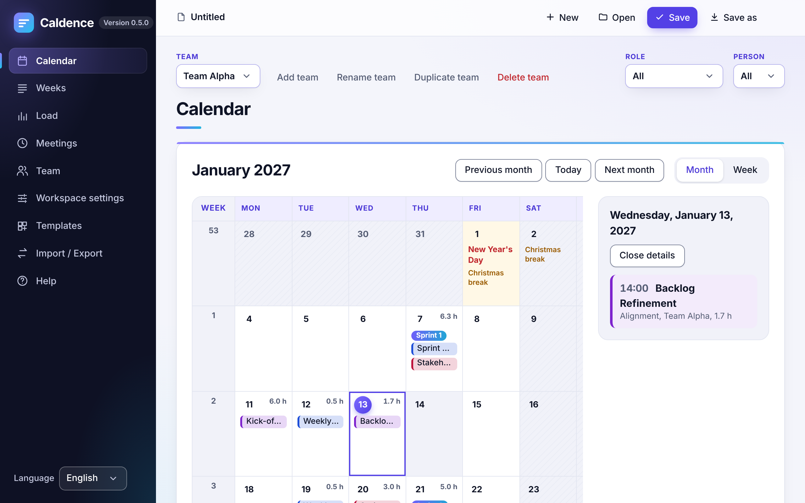
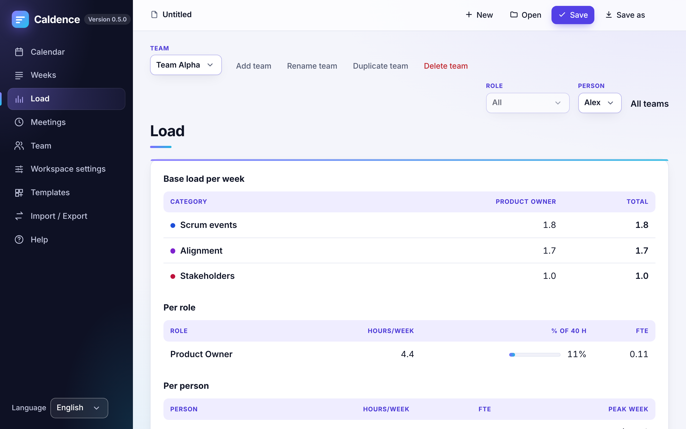
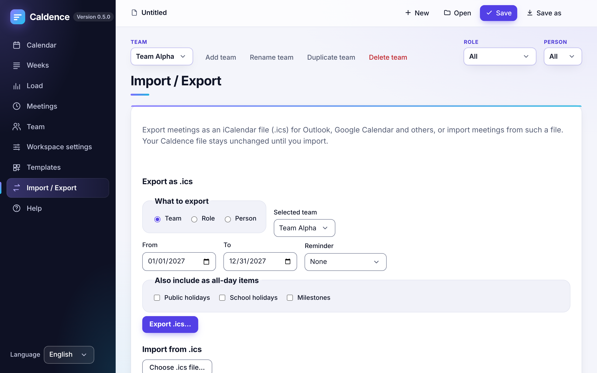

# Caldence

Open-source calendar tool for planning the recurring meetings of agile roles (Product Owner, Scrum Master, teams) and exporting them to Outlook and other calendar apps.

Status: phase 4 – release preparation (installable app, deployment)







## Features

- Teams and roles with people, working hours and load warnings.
- Recurring meetings with rules: weekly, selected weekdays, every n weeks, monthly nth weekday, cadence day, cycle milestone and once.
- Calendar (month and week), weeks and load views, with public and school holidays.
- Templates for Scrum, Kanban and SAFe, plus your own template files.
- Calendar export and import as `.ics` files (Outlook, Google Calendar, Apple Calendar).
- Region files: import your own holiday data.
- Installable app that works offline and asks before updating.
- German and English interface.
- Accessible: keyboard operation, screen reader support, light and dark mode.

## Screenshots

All screenshots are generated by `npm run screenshots`. The German interface: [start](docs/screenshots/start-de.png), [calendar](docs/screenshots/calendar-de.png), [weeks](docs/screenshots/weeks-de.png), [load](docs/screenshots/load-de.png), [meetings](docs/screenshots/meetings-de.png), [templates](docs/screenshots/templates-de.png), [import / export](docs/screenshots/exchange-de.png) and [help](docs/screenshots/help-de.png). The calendar in [dark mode](docs/screenshots/calendar-en-dark.png).

## Quick start

- **Use it online:** open [caldence.de](https://caldence.de) in a current browser.
- **Host it yourself:** download the release ZIP from the GitHub releases page, upload it to a web server and follow the [deployment guide](docs/deployment.md).

## Using Caldence

Open the **Help** view in the app for the first steps, where each setting lives, how files and autosave work, and the keyboard shortcuts. Everything stays in your browser; nothing is sent anywhere.

File formats: [workspace](docs/workspace-format.md), [template](docs/template-format.md) and [region](docs/region-format.md).

## Development

```sh
npm ci           # install dependencies
npm run dev      # start the dev server
npm test         # unit tests
npm run e2e      # end-to-end tests (Playwright)
npm run build    # production build into dist/
```

`dist/` is a static site that can be uploaded to any web server. `npm run package` zips it as `caldence-<version>.zip`. See the [deployment guide](docs/deployment.md).

See [CONTRIBUTING.md](CONTRIBUTING.md) for how to contribute.

## License

Licensed under the [GNU Affero General Public License v3.0 or later](LICENSE) (AGPL-3.0-or-later). If you run a modified version for others, for example on a website, you must offer them its source code.
