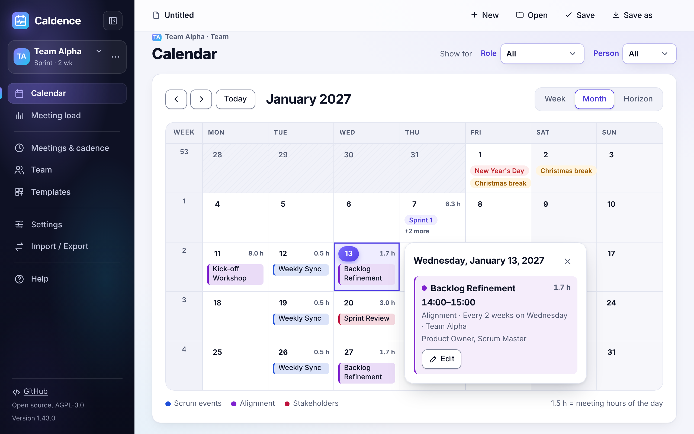
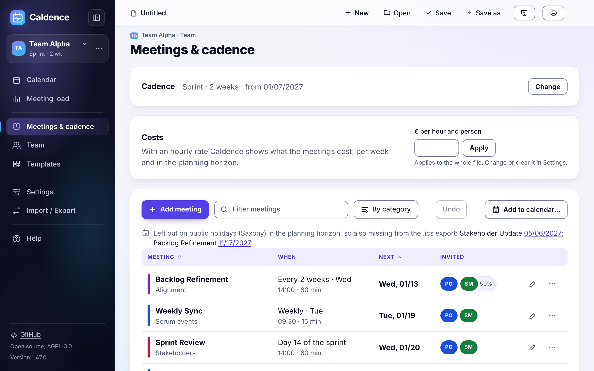
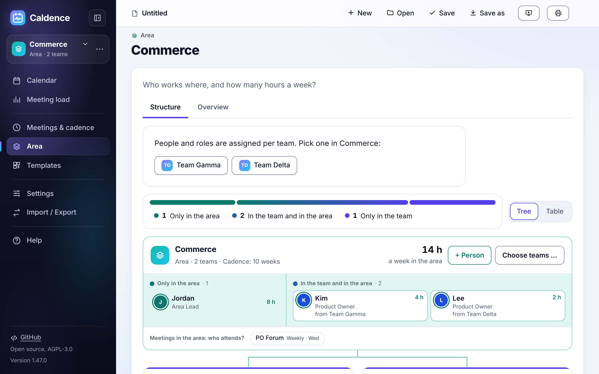

# Caldence

Open-source calendar tool for planning the recurring meetings of agile roles (Product Owner, Scrum Master, teams) and exporting them to Outlook and other calendar apps.

Status: stable, see the [latest release](https://github.com/gallandp/caldence/releases/latest) and the [changelog](CHANGELOG.md). Live at [caldence.de](https://caldence.de).









## Features

- **Plan new:** a short wizard sets up the first team from Scrum, Kanban, SAFe or an empty team, with its people, time zone, holidays and planning horizon. Further teams start from the team menu.
- **Areas:** group several teams into one unit with its own people, hours and meetings, for example a department or a release train. A structure tree shows who works where and how many hours a week; an overview compares the teams' cadences and meeting load (its Meeting load figure names who is over the limit, and a name opens Meeting load at that person; a week is outlined when a member, or someone only in the area, is over the limit, judged on all their teams and areas; a team with a member at 0 h names them next to its share; a team's average counts only full weeks in the planning horizon from its cadence start, a team that is not aligned says why in its cadence column (also on phone cards), and the names under "Differ:" lead to that row), and a click on a team, meeting or week shows it without opening an edit form, with one click back to the overview; on phones its time and cost per team and its most expensive meetings are cards, with the cost on top. Meetings of the area can invite a role from every team; a team that calls such a role differently (Scrum's Developers for SAFe's Agile Team) maps it when it joins the area, or later right from the "missing in team" note on the meeting, in the structure tree or in the meeting form, where a role with the same or a similar name is already selected. The two levels can be renamed (Area/Team, Department/Team, Platform/Product, Chapter/Unit, Release Train/Team or your own names).
- **Organisation:** the top of the tree. With an area or two teams, the sidebar selection starts with the organisation (name it as you like): Calendar and Meeting load then show all teams and areas together, and its page shows the tree organisation → areas → teams, where a click opens a unit. Above the tree the page shows how many teams are aligned (all teams, also those without an area: a team in an area with a cadence of its own is judged as on that area's overview, every other team against the cadence most teams share; those that differ are named, with the reason in the cadence column of the cost table, where a name leads), the meeting load and the meeting cost; below it, the cost per team, grouped under each area with the area's own meetings (teams without an area last), and of the organisation's own meetings, with the same total as Meeting load. Like an area, it can hold people with their hours and meetings of its own, for example a portfolio sync that invites a role from every area or every team; these count in Calendar, Meeting load and costs, and in the what-if bar while presenting. Its page names who attends without hours there, each with a link to set them.
- **Team:** create people and roles where they are assigned; a person can hold several roles and work different weekly hours in each team (for example 20 h in one team and 18 h in another). Adding someone who is already in another team, here or in the setup wizard, fills in the hours they have left (with none left, both propose an even split and lower their other teams to match, unless unticked), and the Team view (member list and people pool), Meeting load and the area structure flag a person whose hours add up to more than the default hours per week. The add-member form shows that person's meeting load before and after. Assumptions such as the team size scale meeting durations. The Team view also lists the people and roles of the whole workspace.
- **Meetings & cadence:** the team's cadence (sprint, flow or program increment; a new length keeps end-of-sprint meetings such as Review and Retrospective at the end), cycles with milestones and the meetings in one place. Repeat rules: weekly, selected weekdays, every n weeks, monthly nth weekday, cadence day, cycle milestone and once. The meetings table sorts by meeting, next date or cost per week (the same order as the area Overview's most expensive meetings) and groups by category; each row shows its cost per week, per sprint or PI and per meeting; on phones each meeting is a card. A meeting is remote or on site; on site, a flat travel time (there and back) counts for everyone attending, in load and costs. Its place or call link shows in the row and card; a web link opens in a new tab. While you edit a meeting, the form shows its effect on hours, meeting load and cost (per week, per sprint or PI and in the planning horizon) before you save, and names the meetings it overlaps for the people it invites.
- **Calendar:** Week, Month and Horizon (every week of the planning horizon in one table), with public and school holidays, the cadence and milestones, and filters for one role or one person across all teams. With an area selected, it shows the meetings of all its teams and its own. Before the plan starts, it opens on the plan's first week (the earliest cadence start), not on empty weeks.
- **Meeting load:** hours per week of everyone in scope (a typical week and the average in the planning horizon), by role and person with their share in meetings (each person judged on all their teams and areas, at most the default hours per week, with their part in the chosen team next to it; the Role filter lists only the people with that role) and their room before the limit, the meetings behind each person's load per team or area (one-offs marked), a weekly chart, and warnings for weeks over the one limit (share of weekly hours in meetings, set in Settings) or with a load spike; peaks that come back with the cadence are ignored. A week in a warning or a person's peak week opens that week in the Calendar with the person filter set. On phones each person is one stacked row with their share, room before the limit and "over the limit" tag (a tap shows where the time comes from), and the people come before the warnings. Missing hours in an area, or area meetings that take most of the hours there, are one hint per person, not weekly warnings. Time in an area is counted on its own and does not raise a team's load. It counts meeting time, including preparation (a meeting with preparation says "incl. X % preparation" in the Calendar and in a person's meetings) and the travel time of on-site meetings, not other work.
- **Meeting costs (optional):** with an hourly rate, Meetings, Meeting load, the area overview and the organisation page show what meetings cost per week and in the planning horizon, which every such figure names (for example "2027, 52 wks"); while presenting, the what-if bar shows the change in both and names whose cost it is (for example "Cost, Payments"). Meetings & cadence and, for a team, Meeting load also show the cost per sprint or PI (not for flow); Meetings & cadence also shows, per meeting, its preparation share and travel time. For a team in an area, its cost card and its row in the area overview also show what the team's people spend in the area's meetings (on the card, and per week in the area overview, also per sprint or PI), split by their weekly hours for people in several teams; this figure is informative and not added to the area total. An area's cost card in Meetings & cadence says it counts only the area's own meetings and names the area total with all teams (the overview's figure) with a link to the overview; the organisation's card does the same, leaving out the areas' meetings too.
- **Present:** shows the plan on a projector with editing out of the way; duration, rhythm and cadence (length and start date) change only as what-ifs, which end with the presentation. On an area overview, the pencil in each cadence row tries another cadence for that team or the area, and "Aligned 2 of 3" changes on the spot. In an area without a cadence of its own, and on the Organisation page, teams stay compared with the cadence from before the what-ifs, so the team you change is the one shown as differing.
- **Print and PDF:** prints the current view, also while presenting with its what-ifs, with one line naming the file, print date, hourly rate and planning horizon.
- Templates for Scrum, Kanban and SAFe (with a Release Train area above the team), plus your own template files; exporting a team as a template also writes its area. A template's level names are only taken into a file without teams.
- Calendar export and import as `.ics` files (Outlook, Google Calendar, Apple Calendar), also one file per team or area as a ZIP (with an area selected in a file with several areas, only that area and its teams; a team's file also holds the area meetings its people are invited to, as the same entries as in the area's file, so importing both adds nothing twice); exporting again updates the entries of the earlier export in apps that support it, keeps a series' earlier start and leaves unchanged entries as they are; the export names the date its series end. Each entry's title names the meeting and its team or area ("Daily Scrum · Alpha"), and a meeting's place or online link becomes its location (an import fills the place from the location). A role invited only part of the time is named in the notes ("Developers: every other time (50%)"), as in the Calendar; the entry itself stays a full series. Meetings on a public holiday of the chosen region are left out; Meetings & cadence and the export name them with their dates beforehand, each date opening that day in the calendar. The export opens on what this browser exported last, or on your own person after "I take part myself" in the wizard.
- Excel export (`.xlsx`) of the whole file for filtering and pivot tables: people per area and team with roles and hours, the areas and teams with their cadence, and all meetings. Built in the browser, no library.
- Public holidays of all 16 German states (school holidays for Saxony so far); region files import your own holiday data.
- Installable app that works offline and asks before updating; works on phones.
- German and English interface; light, dark or matching the system.
- Accessible: keyboard operation, built for screen readers, targeting WCAG 2.2 AA (see the [accessibility statement](docs/accessibility.md)).
- Private: everything stays in your browser; workspaces are files you save and open yourself.

## Screenshots

All screenshots are generated by `npm run screenshots`. The German interface: [start screen](docs/screenshots/start-de.png), [calendar](docs/screenshots/calendar-de.png), [calendar horizon](docs/screenshots/weeks-de.png), [load](docs/screenshots/load-de.png), [meetings](docs/screenshots/meetings-de.png), [area structure](docs/screenshots/structure-de.png), [area overview](docs/screenshots/overview-de.png), [templates](docs/screenshots/templates-de.png), [import / export](docs/screenshots/exchange-de.png) and [help](docs/screenshots/help-de.png). The [area overview](docs/screenshots/overview-en.png) in English, and the calendar in [dark mode](docs/screenshots/calendar-en-dark.png).

## Quick start

- **Use it online:** open [caldence.de](https://caldence.de) in a current browser.
- **Host it yourself:** download the release ZIP from the GitHub releases page, upload it to a web server and follow the [deployment guide](docs/deployment.md).

## Using Caldence

Choose **Plan new** on the start screen, or **Open the example** to look around first. The **Help** view in the app has the first steps, a chapter on every view, one on areas (grouping teams), where each setting lives, how files and autosave work, and the keyboard shortcuts. Everything stays in your browser; nothing is sent anywhere.

If a workspace keeps the app from starting, add `?reset` to the address (for example `https://caldence.de/?reset`) to start with an empty one; see [limits](docs/workspace-format.md#limits).

File formats: [workspace](docs/workspace-format.md), [template](docs/template-format.md) and [region](docs/region-format.md).

## Development

```sh
npm ci           # install dependencies
npm run dev      # start the dev server
npm test         # unit tests
npm run e2e      # end-to-end tests (Playwright)
npm run build    # production build into dist/
```

`dist/` is a static site that can be uploaded to any web server. `npm run package` zips it as `caldence-<version>.zip`. See the [deployment guide](docs/deployment.md).

See [CONTRIBUTING.md](CONTRIBUTING.md) for how to contribute.

## License

Licensed under the [GNU Affero General Public License v3.0 or later](LICENSE) (AGPL-3.0-or-later). If you run a modified version for others, for example on a website, you must offer them its source code.
